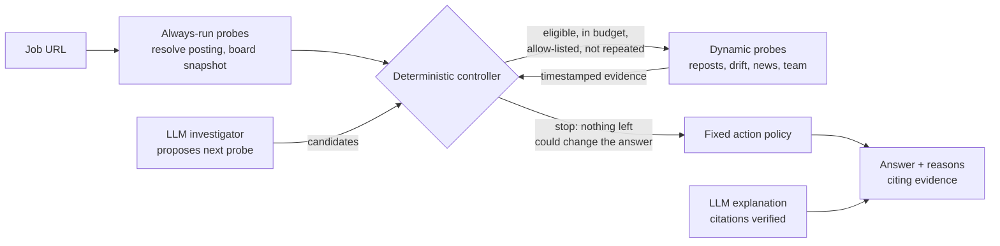

# Job-Liveness Investigator

> **Is this job worth applying to right now, and what should I do next?**

**Status: research project, concluded 2026-10-08.**

**At a glance**

- Built an evidence-backed job-posting investigator: 351 companies, 40,846 postings, a month of daily collection, 1,598 tests.
- Built an LLM agent to choose which checks to run, inside a deterministic controller with budgets, tool allowlists and schema-checked output.
- Built a leak-checked, point-in-time evaluation and an ablation that removes the LLM.
- **Result:** the controller without the LLM matched the agent on **10,587 of 10,588 cases**, so the simpler system is the one to ship. Two independent reviews overturned an earlier, over-optimistic evaluation; every issue they found was fixed and the leak checker now catches it.
- **Product result:** the public signals are too weak to give clearly useful advice (`apply_now` on 3–6% of recent cases; closure prediction barely beats a coin flip). The findings and the reasons are below.

## What it is

Many job postings online are not what they seem. Some were filled months ago
and never taken down. Some are reposted again and again. Some belong to
companies that have just frozen hiring. Job seekers waste hours tailoring
applications for jobs that were never really open.

`rli` takes a job link and checks the evidence before you spend that time:

- **Is the posting still live** on the company's own hiring system?
- **How fresh is it?** When was it published or last refreshed?
- **Has it been reposted** over and over, or open for a very long time?
- **What is the company doing?** Is it hiring more people on the same team, or are there layoffs or a hiring freeze in the news?

It then gives one of four answers:

| Answer | Meaning |
|---|---|
| **apply_now** | Strong, fresh evidence the job is real and wanted. Put in real effort. |
| **quick_apply** | Probably open, but the evidence is thin. Apply with little tailoring. |
| **wait** | Something is unresolved, for example news of a hiring freeze. Check again in N days. |
| **skip** | Closed, or a long-running repost with signs the company is not really hiring. |

Every answer comes with short reasons, and each reason links to the dated
source it is based on. The tool never claims a job is "fake". It only reports
what the evidence shows and how strong that evidence is.

## How it works

1. **Collect.** Every day it records the job boards of 351 tech companies that
   use Greenhouse, Ashby or Lever. It also pulls older copies of those boards
   from the Wayback Machine, plus dated company news (funding, layoffs, freezes).
   This history is what lets it spot reposts and long-open jobs.
2. **Investigate.** For a given link it runs small checks called *probes*, such
   as "is it still on the board?", "has it been reposted?", "is the team
   hiring?" and "any company news?". Each probe produces timestamped evidence.
3. **Decide.** A fixed, rule-based policy turns the evidence into one of the
   four answers. The decision is always made by these rules, never by an AI.
4. **Explain.** The answer comes with reasons that cite the evidence.

## Agent engineering and evaluation



**How the agent is built**

- **The LLM never decides.** It proposes which probe to run next and drafts the explanation. A fixed policy makes the decision.
- **A deterministic controller decides what actually runs.** It only allows a probe that could still change the answer, enforces step, token and cost budgets, blocks repeated calls, checks every argument against a schema, and stops when no remaining probe can change the outcome.
- **Safe tool use.** Every network call goes through a per-probe domain allowlist with SSRF checks. Job and news text reaches the LLM only inside a delimited "untrusted" block, never as instructions.
- **Checked output.** LLM output must match a Pydantic schema. Every reason must cite evidence IDs that exist and support the claim; unsupported citations are dropped and counted.
- **Reproducible runs.** Tool calls and LLM answers are cached (LLM cache keyed by model, prompt hash and input hash), so a full evaluation replays offline, with cost tracked per call. A sharded runner ran 10,588 agent cases with 4 parallel workers.

**How it was evaluated**

- **Point-in-time replay.** Each test case is a job at a past date T. Systems see only evidence available at T; live network calls are blocked during replay.
- **A leak checker** audits every run, including evidence stamped before it was really fetched.
- **Frozen splits.** A time split and a company split (no shared companies), with held-back test companies excluded from every tuning set.
- **Four systems compared:** A runs every probe (the reference), B is a hand-written checklist, C is the LLM agent, and R is C's controller with the LLM removed.
- **Honest metrics.** Agreement is also reported on the cases where a probe could change the answer, because agreement over all cases is close to automatic.
- **Adversarial review.** Two independent reviews found that an earlier evaluation leaked data and over-credited the agent. Everything they found was fixed and re-verified before the final numbers.

## Findings

**Data collected** (2026-09-07 to 2026-10-08)

| | |
|---|---|
| Companies tracked (Greenhouse, Ashby, Lever) | 351 |
| Job postings seen | 40,846 |
| Posting closures observed (as date ranges) | 24,494 |
| Days of own collection | 27 |
| Wayback board captures / repost links / dated company events | 1,452 / 2,348 / 773 |

**1. A leak-checked evaluation was built and passes.** Each test case is a job
at a past date, and every system may only see evidence available on that date.
Final test sets (2026-10-08): `dev-7d-v4` (330 jobs, 196 companies, 8,891 cases)
and `company-7d-v4` (330 jobs, 64 different companies, 1,452 cases). Both meet the
size targets, pass the leak check, and keep the held-back test companies out.
Reports: `reports/evaluation.md`, `reports/evaluation_company_split.md`.

**2. The ablation removed the LLM, and nothing changed.** The controller without
the LLM (system R) reproduced the agent's checks and answers on 10,587 of 10,588
cases. The value came from the controller's rule "only run a probe that could still
change the answer", not from the model. R makes the same decisions as the full
system while running 5–31% fewer expensive checks than the hand-written rules (B).
So the system to ship is R: same answers, no LLM cost, no model risk. The spec
required this outcome whenever rules prove equally good.

**3. Most answers fall back to `quick_apply`.** On recent cases, 85–95% of the
evidence is weak, so `apply_now` is only 3–6% of answers:

| Recent cases | apply_now | quick_apply | wait | skip |
|---|---|---|---|---|
| Time split (525) | 16 | 338 | 9 | 162 |
| Company split (1,447) | 85 | 1,228 | 50 | 84 |

The main reason is missing publish dates: dates were only saved from 2026-10-04,
and older jobs have no dated history.

**4. The signals barely predict whether a job is a real, active hire.** A pilot
(branch `pilot/wayback-job-pages`) pulled a year of archived job pages for 20
companies and tested whether a job closes within 60 days (AUC: 0.5 = coin flip):

| Predictor | AUC |
|---|---|
| Job age alone | 0.49–0.55 |
| Age + company habits + reposts + team hiring | 0.53–0.67, unstable |

Only company habits help, and only between companies. Reposted jobs close at
about the same rate as others once age is accounted for.

**5. Archived job pages fix dates, not signal.** Archived Greenhouse pages give
the real first-publish date (342 of 342 matched) and would turn about half the
affected time-split cases strong, but they add no predictive power.

**6. Proving the advice would need real outcomes at scale.** Detecting a
difference in reply rates between `apply_now` and `quick_apply` needs roughly
1,000–3,000 logged applications from 10+ people. None were logged, so
**product value is unproven**.

**Mistakes found and fixed along the way.** Two independent reviews found that an
earlier evaluation (2026-09-30) overstated the agent and leaked data: evidence
stamped hours before it was fetched, Ashby's "last published" date read as
"first published", a company split that overlapped the time split, and an
agreement score that was close to automatic. All were fixed, the leak checker was
extended to catch them, and the test sets were rebuilt. Details: `PROGRESS.md`.

**What would be worth building instead.** An alert for brand-new postings (most
applications go to jobs from the last 48 hours), and simple company facts such as
"this company keeps 35% of its jobs open over 90 days", without prediction claims.

## Run it yourself

**Requirements:** Linux or macOS, Python 3.12, [uv](https://docs.astral.sh/uv/),
and internet access. The agent (System C) also needs an LLM endpoint; see step 5.

### 1. Install and create the database

```bash
git clone git@github.com:areebfazli/job_liveliness_investigator.git
cd job_liveliness_investigator
uv sync
uv run rli init-db --path ./data/rli.db
uv run rli load-targets --targets scripts/targets.csv --db ./data/rli.db
uv run rli load-events --path data/events/company_events.csv --db ./data/rli.db
```

### 2. Collect data

```bash
uv run rli snapshot --db ./data/rli.db                       # today's job boards (~4 min)
uv run rli archive backfill --months 12 --db ./data/rli.db   # older copies from Wayback (slow)
uv run rli history rebuild --db ./data/rli.db                # derive closures and reposts
```

To collect every day automatically, run `scripts/setup_laptop_timer.sh`. It
installs a systemd timer that runs at 00:05 and 12:05 and catches up after
sleep. For an always-on machine, use `scripts/setup_cloud_vm.sh`. Both are
described in `docs/deploy-snapshot.md`.

### 3. Check a job link

```bash
uv run rli run --system B --url https://boards.greenhouse.io/<company>/jobs/<id> --db ./data/rli.db
uv run rli agent run --url https://boards.greenhouse.io/<company>/jobs/<id> --db ./data/rli.db   # agent (C)
```

### 4. Web page and API

```bash
RLI_DB_PATH=./data/rli.db uv run python -m rli.api    # then open http://localhost:8000/
```

- `POST /investigate {url, system}` returns the answer. If the LLM is unreachable, it falls back to the rules (B) and marks the response `degraded: true`.
- `POST /outcomes` logs what happened after you applied: `applied`, `reply`, `screen`, `interview`, `offer`, `rejection` or `silence`. These outcomes are what can eventually show whether the advice works.
- `/watch` lets you watch a job and have it rechecked when it is due.
- The server runs on localhost only, unless you set `RLI_API_TOKEN`; then every request needs that token. `RLI_API_RPM` sets the per-IP rate limit.

### 5. LLM for the agent (System C)

C works with any OpenAI-compatible endpoint. Set it in `config.toml` under `[llm]`.
The default is Mistral:

```bash
echo 'MISTRAL_API_KEY=...' > .env    # free key at console.mistral.ai; .env is gitignored
```

The posting title, URL, company name, evidence snippets and news headlines
are sent to that provider, and free tiers may train on them. To keep
everything local, use Ollama (`base_url = "http://localhost:11434/v1"`) with a
model that supports structured JSON output.

### 6. Reproduce the evaluation

```bash
uv run rli replay build --dataset my-set --split dev --split-kind temporal --grid-days 7 --db ./data/rli.db
# company holdout: same command with --split-kind company, company-disjoint from my-set
uv run rli replay build --dataset my-company-set --split dev --split-kind company --grid-days 7 --exclude-companies-from my-set --db ./data/rli.db
uv run rli replay run --system A --dataset my-set --db ./data/rli.db
uv run rli replay run --system B --dataset my-set --db ./data/rli.db
uv run rli replay run --system R --dataset my-set --db ./data/rli.db   # controller without the LLM
WORKERS=4 TOTAL_RPM=160 scripts/replay_c_parallel.sh my-set   # agent, 4 workers in parallel
uv run rli replay check --dataset my-set --db ./data/rli.db   # must report 0 leaks
uv run rli eval run --dataset my-set --with-c --with-r --out reports/evaluation.md --db ./data/rli.db
```

`replay build` is the only replay step that uses the network. Every later step
is replayed offline, with live calls blocked. Each case's split is frozen when
the dataset is built, so evaluation never re-splits a corpus that has grown since.

### 7. Tests

```bash
uv run pytest -q && uv run ruff check .    # 1,598 tests
```

## Built-in safety rules

- **No looking ahead.** Evidence is stamped with when it became available. Replay sees only data from on or before the test date, and every replay run is audited for leaks.
- **The AI never decides.** It only picks probes and writes the explanation. Its output must match a schema, it can call only allow-listed sites, it has hard budget and step limits, and it cannot repeat the same call.
- **Job and news text is treated as data**, never as instructions to the AI.
- **No guessing.** A failed or missing capture is recorded as a gap, never as "job closed". Closure dates are kept as ranges, never invented.
- **Every reason must cite real evidence**, and this is checked.
- **Out of scope:** no "ghost job" verdicts, no LinkedIn scraping, no crowd scores, no made-up 0–100 scores.

## More detail

| File | What's in it |
|---|---|
| `spec.md` | Full requirements, including the action policy and its amendments |
| `PLAN.md` | Build order |
| `PROGRESS.md` | Running log of status and decisions |
| `config.toml` | All thresholds, budgets, rate limits and allowlists |
| `reports/` | Final evaluation reports (`reports/archive/` holds earlier ones) |
| `docs/` | Deployment and demo walkthroughs |

```
rli/  net · resolvers · snapshots · archive · history · events · probes
      policy · eval · agent · llm · replay · api · ui · cli.py
```
